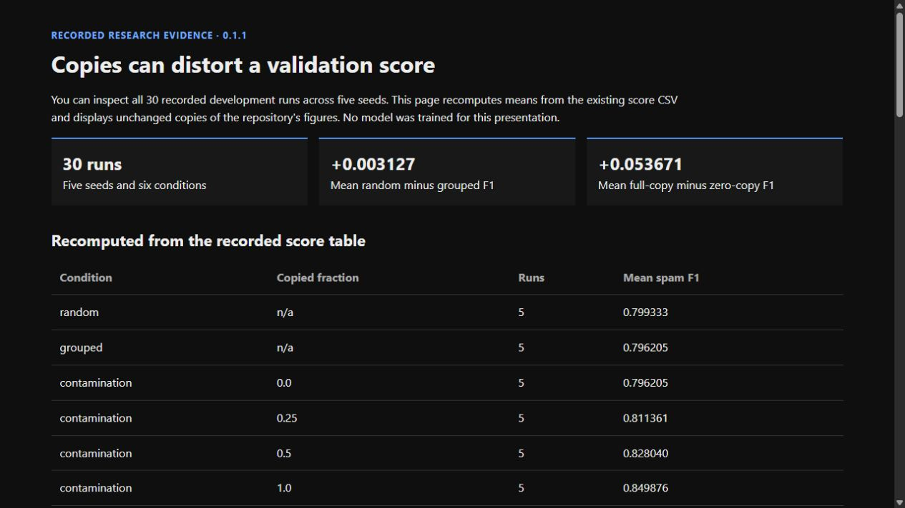
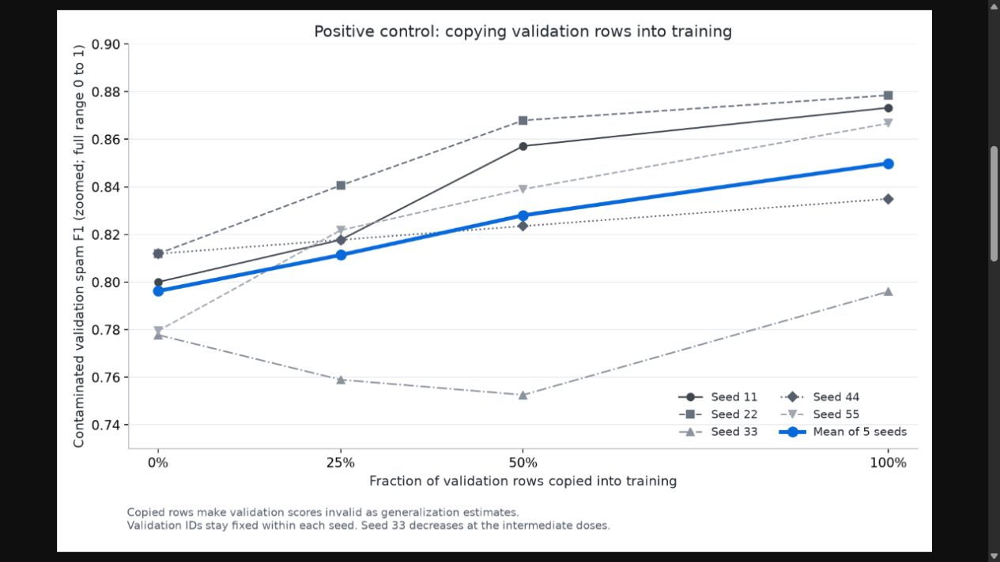
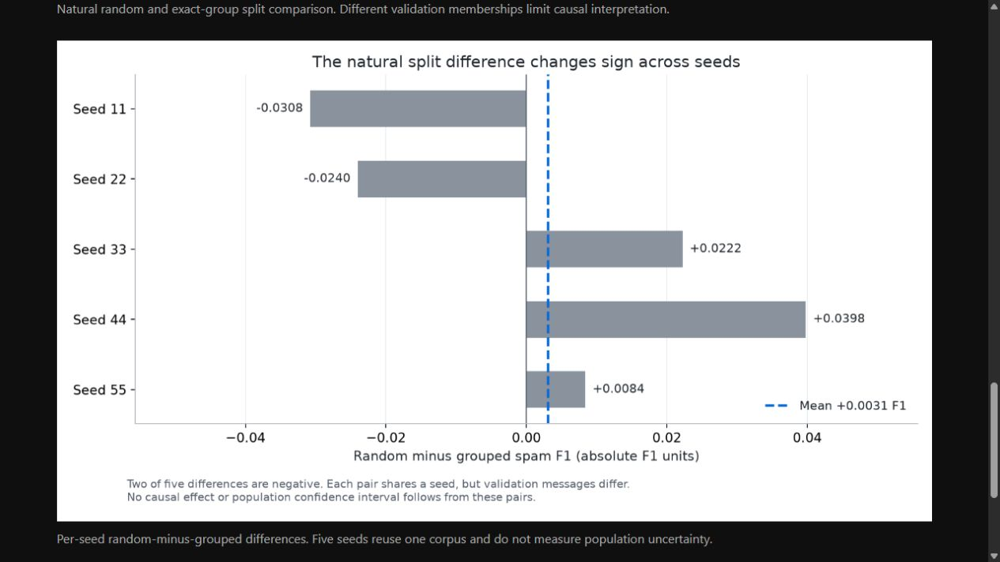

# Duplicate Leakage Study: annotated walkthrough

Current source version: **0.1.1**. Capture date: **2026-10-21**.

The gallery presents recorded figures and independently recomputed CSV means. It does not retrain models or claim scientific novelty. Read protocol, split memberships and per-seed results; five reused-corpus seeds do not estimate population uncertainty.

[Image hashes and timestamp basis](../screenshot-manifest.json). Captions distinguish current calculation, retained state and recorded research.

[English project guide](../guides/duplicate-leakage-study.md).

## 01. Recompute the recorded score table

Calculate means from 30 existing runs, five seeds and six conditions. This presentation performs no new model training and retains the recorded protocol.

1265 × 712 px · actual browser screenshot · source 0.1.1

## 02. Expose score inflation

Inspect the unchanged positive-control figure. Copying validation rows into training invalidates generalization estimates. The axis is zoomed and individual seeds need not improve at every dose.

1265 × 712 px · actual browser screenshot · source 0.1.1

## 03. Show variation and causal limits

Inspect every random-minus-grouped seed difference, including negative values. Different validation memberships prevent a causal interpretation of the natural split comparison.

1265 × 712 px · actual browser screenshot · source 0.1.1
