# MicroBrain Pocket: annotated walkthrough

Current source version: **0.2.0**. Capture date: **2026-10-21**.

Fresh Android captures cover retained state, source journal, diagnostics, budget/approval controls and data-transfer/checkpoint controls. The session preserves existing memory, cancels expansion and performs no reset, import or checkpoint overwrite. The local inference-chain walkthrough, optional provider, consolidation/evolution and background restart recovery were not newly exercised; retain the source and existing JVM/Android proof. Current UI and command grammar use Russian. This is a bounded symbolic experiment, with no LLM inside one MiB.

[Image hashes and timestamp basis](../screenshot-manifest.json). Captions distinguish current calculation, retained state and recorded research.

[English project guide](../guides/microbrain.md).

## 01. Open the current Pocket application

Inspect the installed Android package org.microbrain.pocket 0.2.0. The retained Q5 research message comes from an earlier demo session; this is not a newly generated conversation.

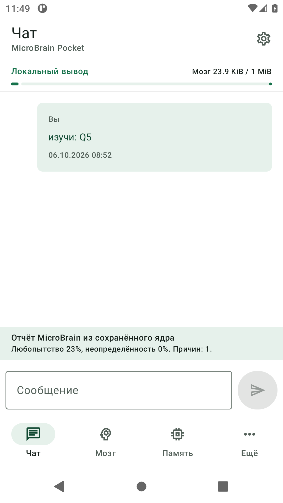

1080 × 1920 px · Android adb screencap · source 0.2.0

## 02. Inspect explicit retained state

Read the memory-use and belief counts from the running app. The persistent brain allowance excludes the APK and Android runtime.

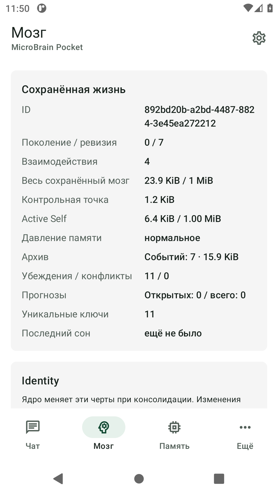

1080 × 1920 px · Android adb screencap · source 0.2.0

## 03. Browse retained beliefs

Inspect the Q5 topic and source-reported Wikidata facts. Source reports remain distinct from independently verified truths.

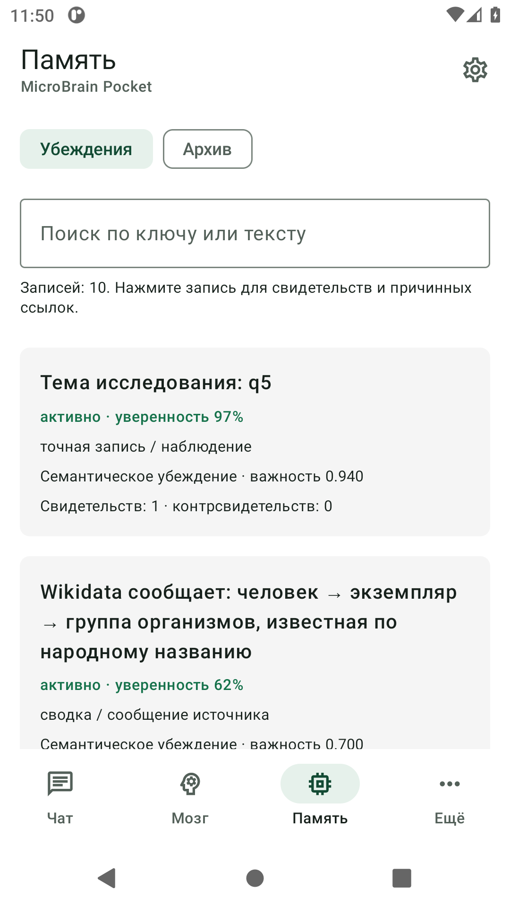

1080 × 1920 px · Android adb screencap · source 0.2.0

## 04. Find the inspection tools

Open More to locate affect, consolidation, evolution, invariant diagnostics and settings. This screen shows navigation, not execution of every tool.

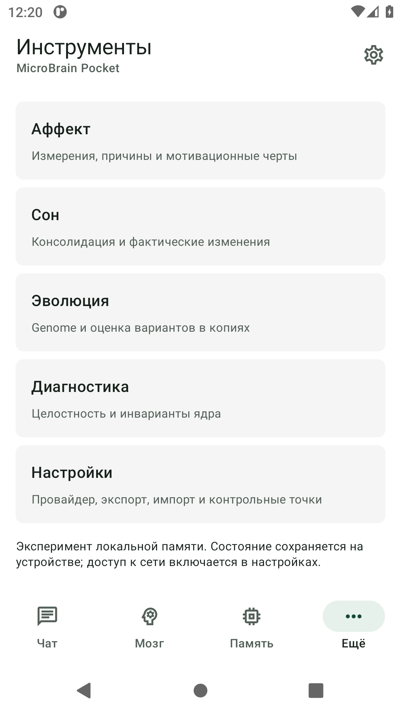

1080 × 1920 px · Android adb screencap · source 0.2.0

## 05. Read current invariants

Open Diagnostics. Eight current invariant checks pass, including schema, budget and canonical roundtrip. This does not constitute a fresh full Android test suite.

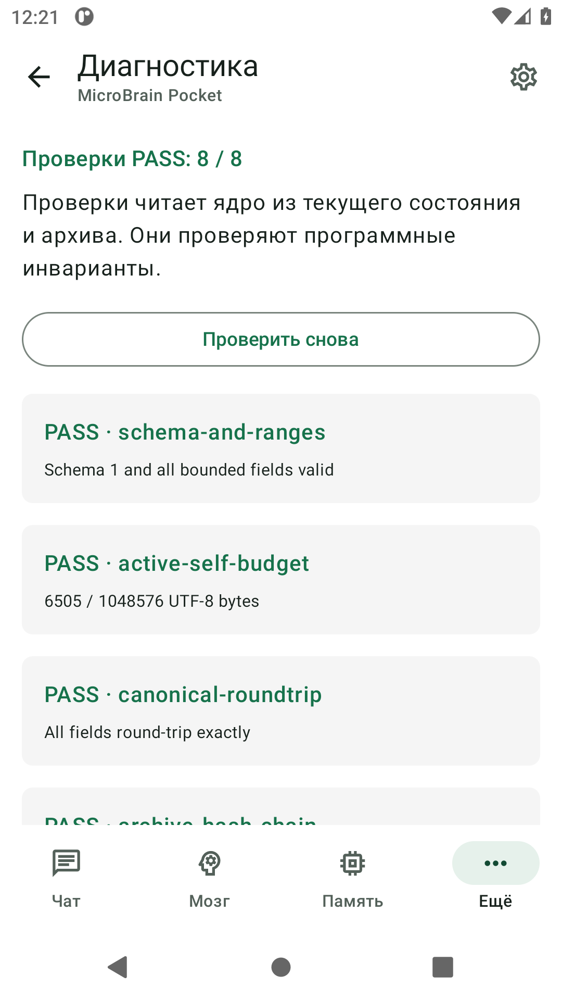

1080 × 1920 px · Android adb screencap · source 0.2.0

## 06. Inspect the structured research topic

Open settings for retained topic q5. WorkManager scheduling depends on Android network and power conditions; a screenshot does not prove restart recovery.

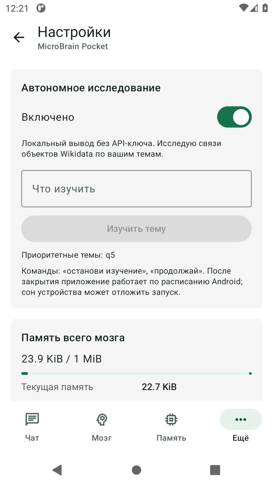

1080 × 1920 px · Android adb screencap · source 0.2.0

## 07. Account for persistent storage

Inspect the current state, checkpoint and shared one-MiB limit. Lower-priority records may be forgotten when the bounded store fills.

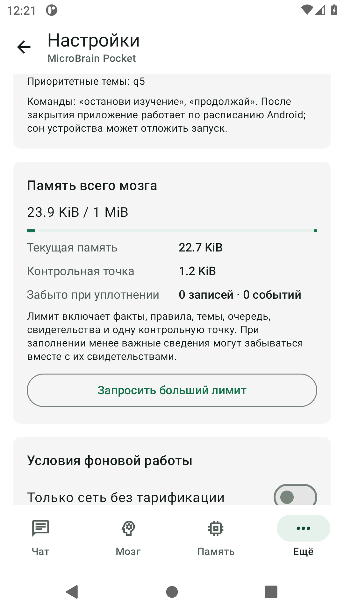

1080 × 1920 px · Android adb screencap · source 0.2.0

## 08. Require explicit memory approval

Request two MiB and open the confirmation dialog. The capture session cancels it and retains the one-MiB limit. It does not approve an expansion.

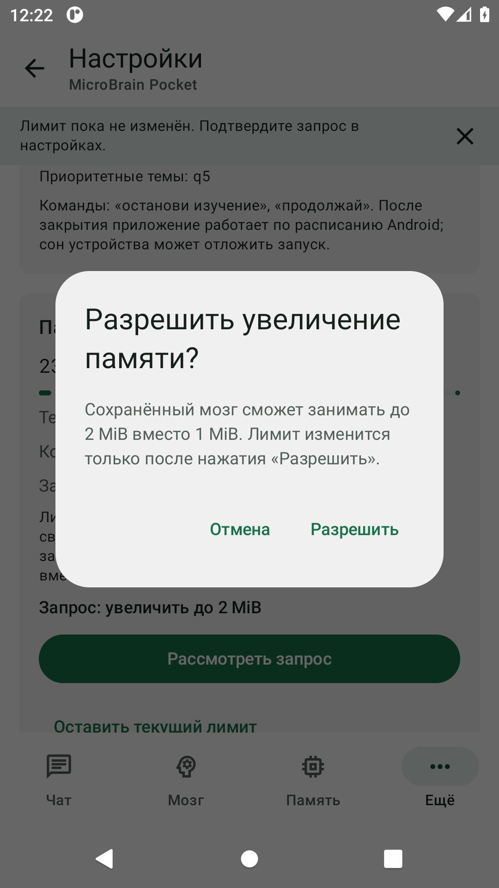

1080 × 1920 px · Android adb screencap · source 0.2.0

## 09. Trace retained source evidence

Read the existing Wikidata journal and the note that claims require checking. Scroll the journal to inspect each source URL. The retained source report is not evidence of general article understanding.

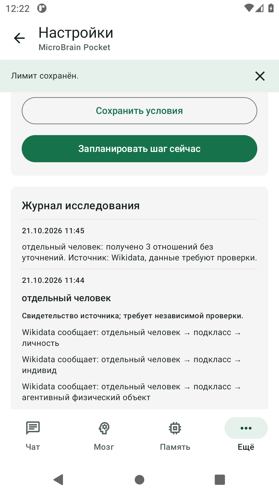

1080 × 1920 px · Android adb screencap · source 0.2.0

## 10. Inspect export and import boundaries

Open the data-transfer controls. Export contains retained state and events; it excludes provider keys and memory-expansion permission. No import or reset occurs in this capture.

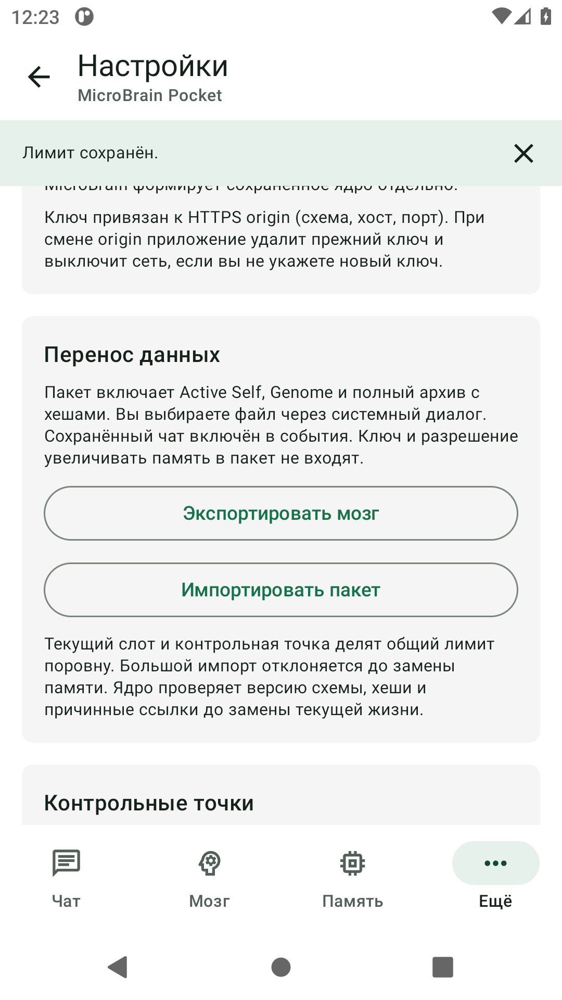

1080 × 1920 px · Android adb screencap · source 0.2.0

## 11. Inspect the bounded checkpoint

Open checkpoint controls. The app retains one checkpoint and explains that the next save replaces it. The capture session does not overwrite the existing checkpoint.

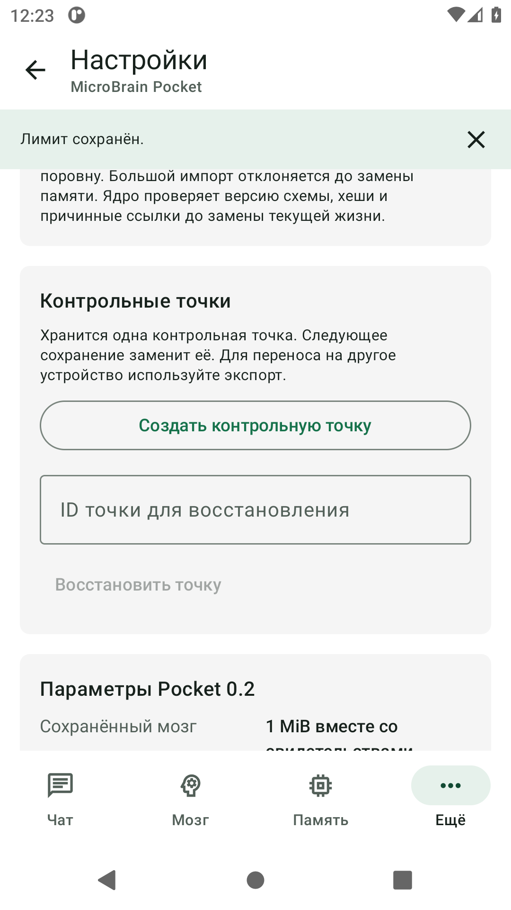

1080 × 1920 px · Android adb screencap · source 0.2.0
