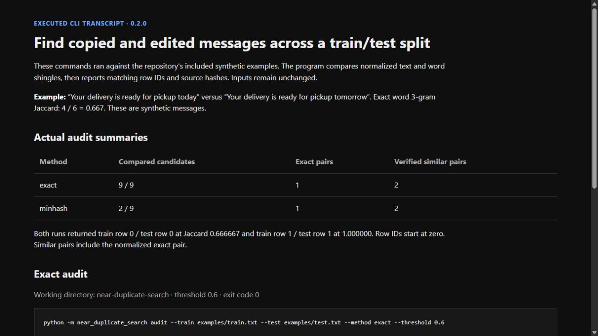
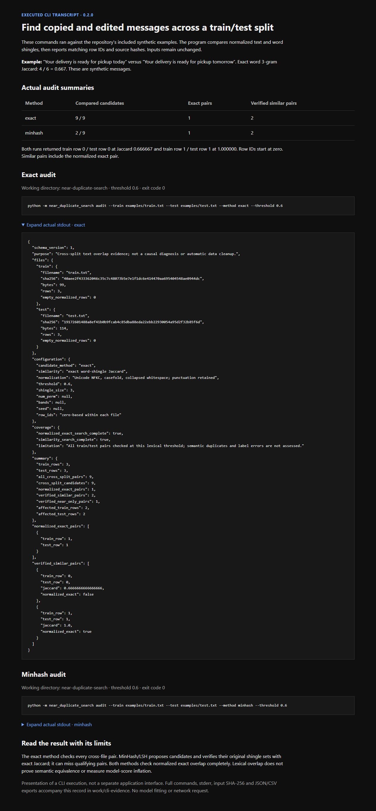

# Near-Duplicate Search: annotated walkthrough

Current source version: **0.2.0**. Capture date: **2026-10-21**.

The two screenshots present actual CLI commands, stdout and synthetic input IDs. Oracle agreement, deterministic hashing and approximate-search misses require the source tests and benchmark records. This small example cannot establish general speed superiority.

[Image hashes and timestamp basis](../screenshot-manifest.json). Captions distinguish current calculation, retained state and recorded research.

[English project guide](../guides/near-duplicate-search.md).

## 01. Compare exact and approximate candidate search

Run both CLI methods on the included synthetic files. Exact checks nine pairs; MinHash proposes two candidates. Both return one exact pair and two verified similar pairs, including that exact pair.

1265 × 712 px · actual browser screenshot · source 0.2.0

## 02. Inspect the actual JSON transcript

Expand stdout from the executed exact audit. Row IDs, Jaccard values and source hashes come from the program. This page presents a CLI execution, not a separate graphical product.

1265 × 2725 px · actual browser screenshot · source 0.2.0
