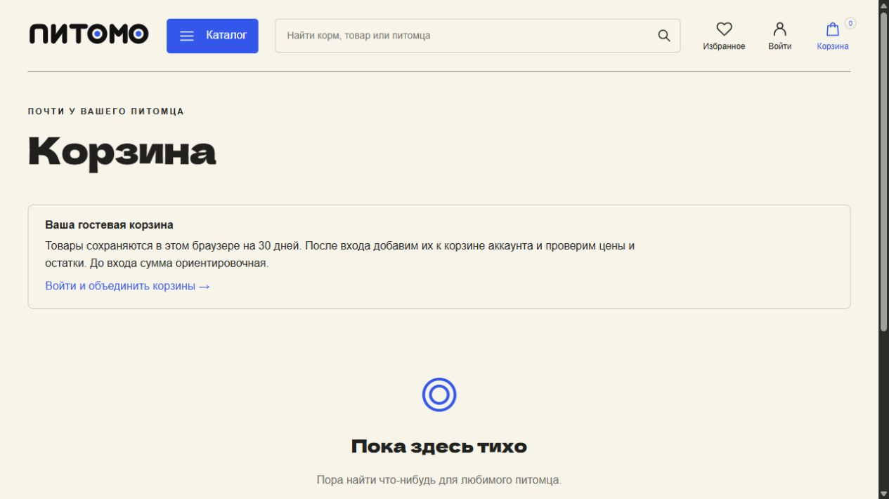

# Pitomo: annotated walkthrough

Current source version: **0.14.0**. Capture date: **2026-10-21**.

Fresh anonymous captures cover storefront, filters, product, guest cart, mobile, empty cart and sign-in entry. Account-only checkout, address book, reordering, delivery stages, admin stock/moderation and exports are documented in the English guide and source; they were not captured with customer or administrator data in this session. Backend/database records, not these images, support transactions and authorization. Payments are simulated; no live courier integration or hosting is claimed.

[Image hashes and timestamp basis](../screenshot-manifest.json). Captions distinguish current calculation, retained state and recorded research.

[English project guide](../guides/pitomo.md).

## 01. Enter the demonstration storefront

Open the running React/FastAPI shop. The current interface uses Russian; English captions explain the existing application.

1265 × 712 px · actual browser screenshot · source 0.14.0

## 02. Explore the storefront on a narrow screen

Inspect the actual responsive home layout. The cat illustration belongs to the product design, not a screenshot mockup.

375 × 812 px · actual browser screenshot · source 0.14.0

## 03. Browse demo products

Open the catalog with its category, stock, price and sorting controls. Product records are local demonstration data.

1265 × 712 px · actual browser screenshot · source 0.14.0

## 04. Combine pet and category filters

Filter to cats and toys. The URL and selected chips retain both filters and the response contains one matching item.

1265 × 712 px · actual browser screenshot · source 0.14.0

## 05. Inspect a product before adding it

Open the demo cat-food page with its price, stock/variant information and product actions. Prices use tenge in the current locale.

1265 × 712 px · actual browser screenshot · source 0.14.0

## 06. Use the anonymous cart

Add one demonstration product. The guest cart shows the item and estimated total; the capture session does not submit an order or payment.

1265 × 712 px · actual browser screenshot · source 0.14.0

## 07. Review the cart on a narrow screen

Inspect the same one-item guest cart in the responsive layout. Account merge and stock revalidation need separate behavioral tests.

375 × 812 px · actual browser screenshot · source 0.14.0

## 08. Explain guest retention and the empty state

Remove the capture session item. The empty cart explains 30-day browser retention and the merge after sign-in.

1265 × 712 px · actual browser screenshot · source 0.14.0

## 09. Inspect the account entry point

Follow the cart sign-in link. The login screen retains the cart return destination. No account credentials or customer data enter these images.

1265 × 712 px · actual browser screenshot · source 0.14.0
