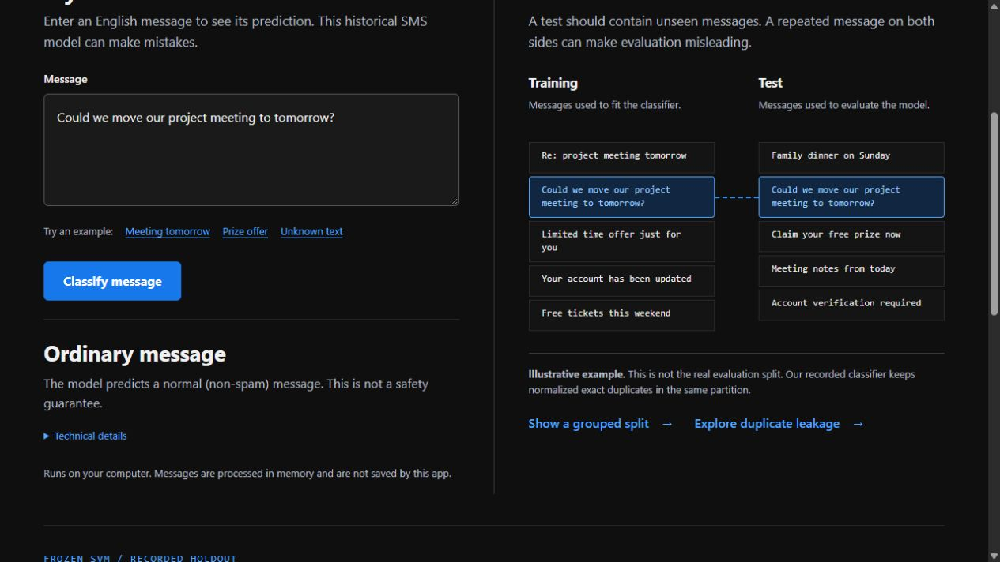
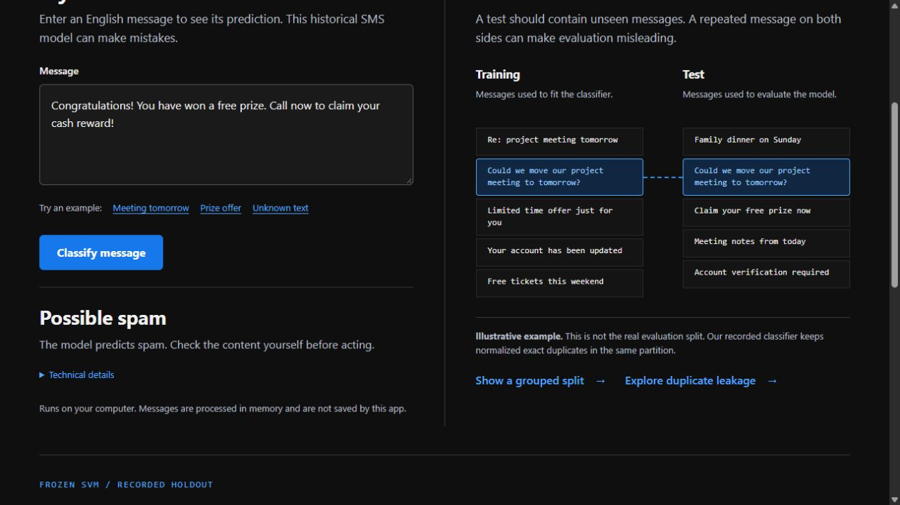
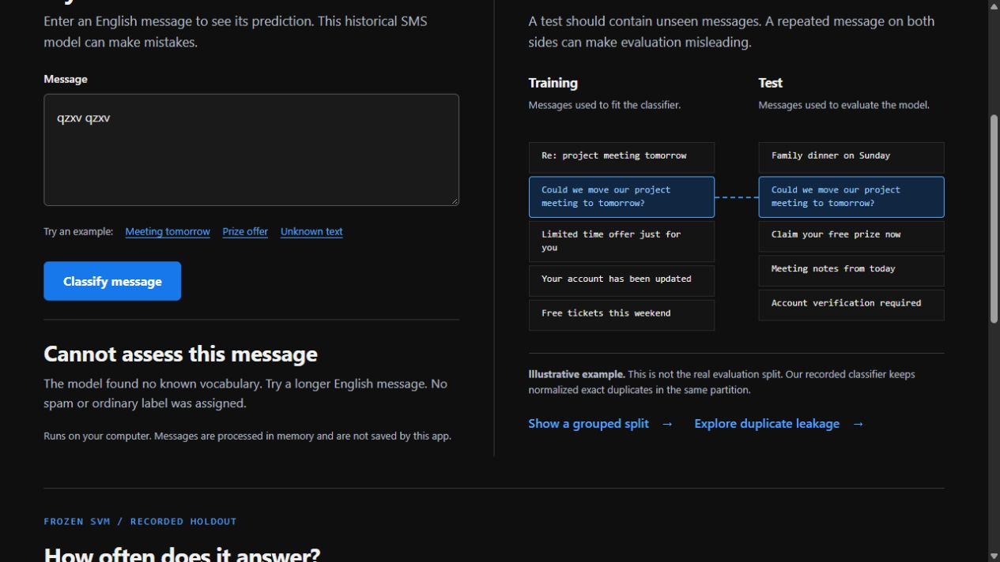
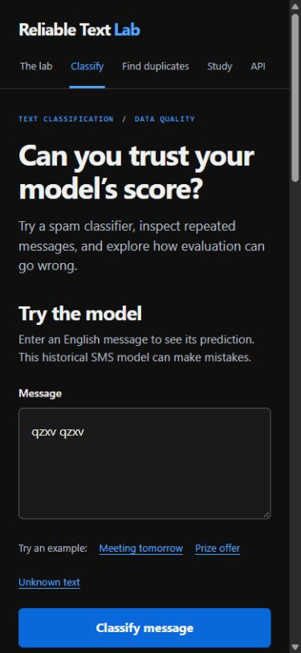
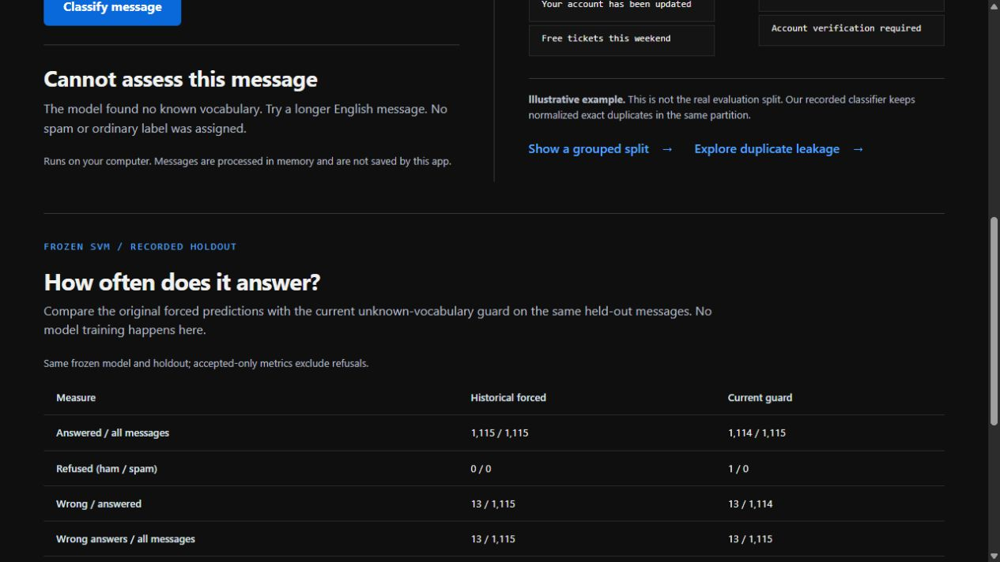
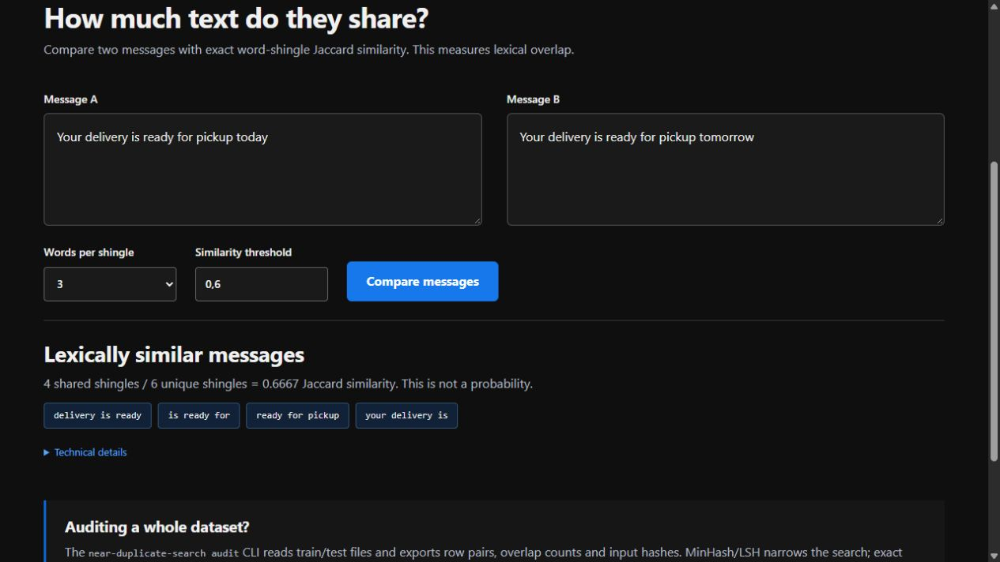
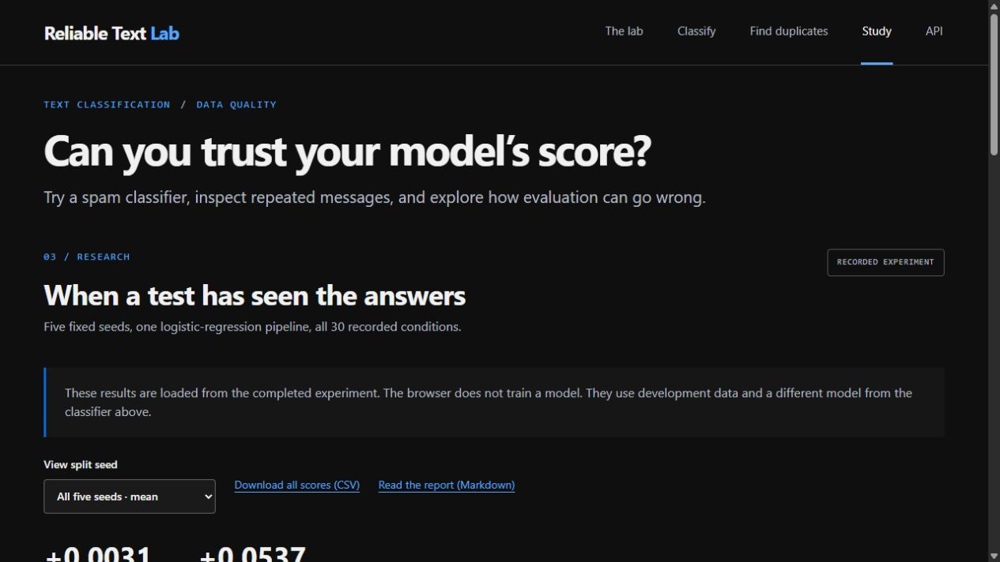
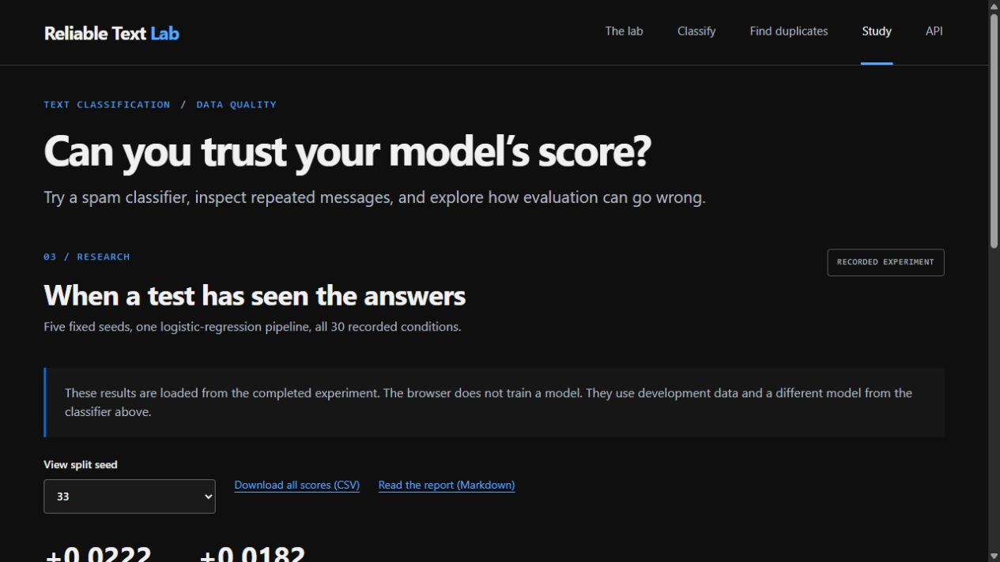
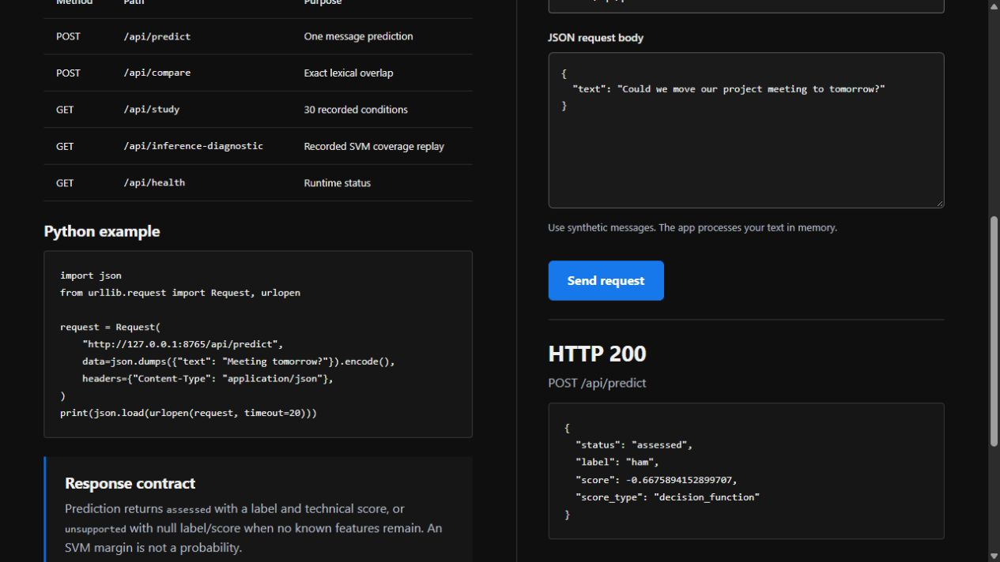
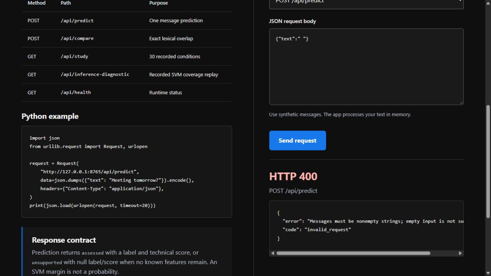

# Reliable Text Classifier: annotated walkthrough

Current source version: **0.2.1**. Capture date: **2026-10-21**.

Fresh screens cover completed predictions, unsupported input, diagnostics, overlap, recorded study and API. Split isolation, vocabulary fitting and model metrics require the retained tests and source records. Historical English SMS performance does not establish current Chinese-language performance.

[Image hashes and timestamp basis](../screenshot-manifest.json). Captions distinguish current calculation, retained state and recorded research.

## 01. Inspect an ordinary message

Classify the synthetic project-meeting message with the included SVM. The interface returns an ordinary-message label; a decision margin is not a probability.

1265 × 712 px · actual browser screenshot · source 0.2.1

## 02. Inspect a possible spam message

Classify the included synthetic prize example. The interface returns a possible-spam label, which still needs human judgment.

1265 × 712 px · actual browser screenshot · source 0.2.1

## 03. Refuse unsupported vocabulary

Submit qzxv qzxv. With no known features, the application withholds the label instead of forcing a ham prediction.

1265 × 712 px · actual browser screenshot · source 0.2.1

## 04. Read a refusal on a narrow screen

The responsive layout preserves the unsupported-input explanation. This is browser viewport evidence, not a physical-device test.

375 × 812 px · actual browser screenshot · source 0.2.1

## 05. Count answers and mistakes

Inspect the recorded holdout diagnostic: 1,114 of 1,115 inputs receive answers and 13 predictions remain wrong. Historical forced-prediction metrics retain their original denominator.

1265 × 712 px · actual browser screenshot · source 0.2.1

## 06. Explain lexical overlap

Compare today versus tomorrow delivery messages. Four shared word three-grams divided by six unique three-grams gives Jaccard 0.667. This is overlap, not semantic probability.

1265 × 712 px · actual browser screenshot · source 0.2.1

## 07. Inspect the companion study

Read all 30 recorded development conditions across five fixed seeds. The browser loads measured results and does not train a model.

1265 × 712 px · actual browser screenshot · source 0.2.1

## 08. Keep a negative result visible

Filter to seed 33. Intermediate contamination doses do not increase F1 monotonically, so the explanation keeps that limitation.

1265 × 712 px · actual browser screenshot · source 0.2.1

## 09. Make a real prediction request

Send POST /api/predict. The local service returns HTTP 200 with the ham label and an SVM decision margin, separate from probability.

1265 × 712 px · actual browser screenshot · source 0.2.1

## 10. Reject an empty message

Send blank text. The server returns HTTP 400 and a structured validation response.

1265 × 712 px · actual browser screenshot · source 0.2.1
