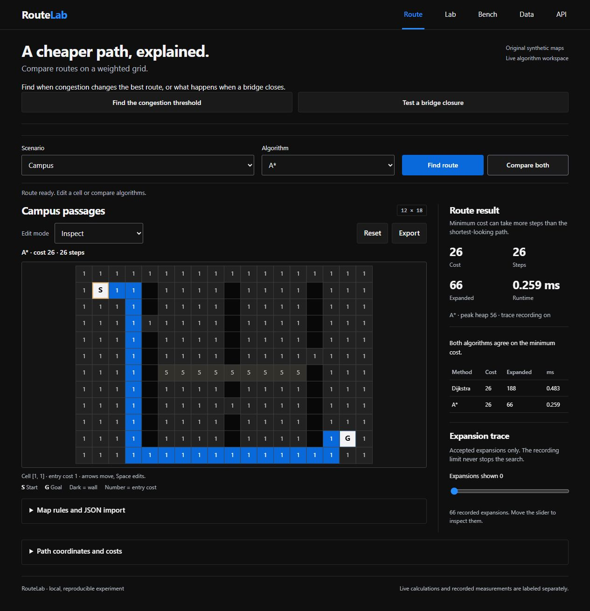
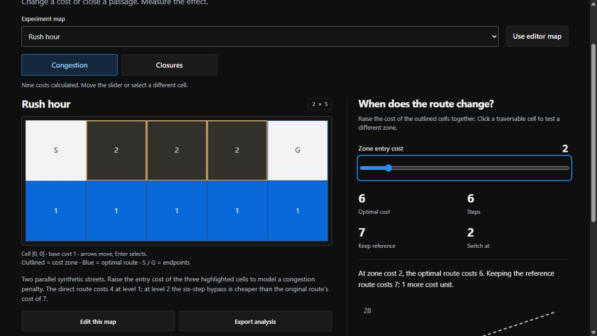
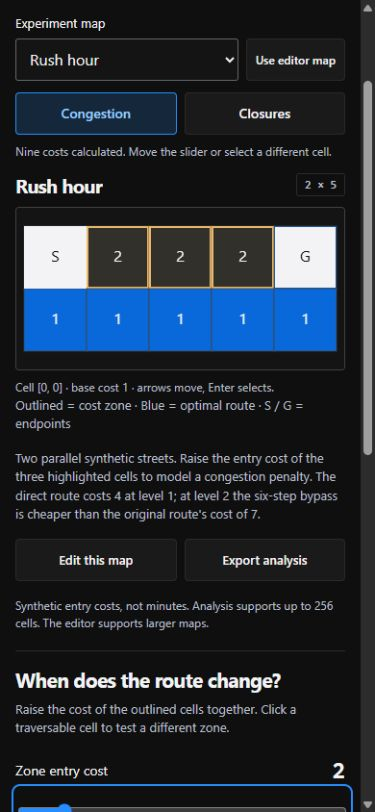
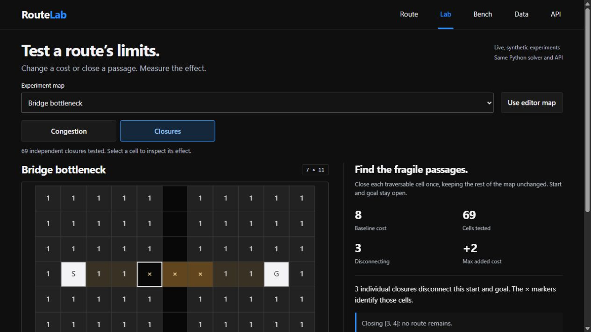
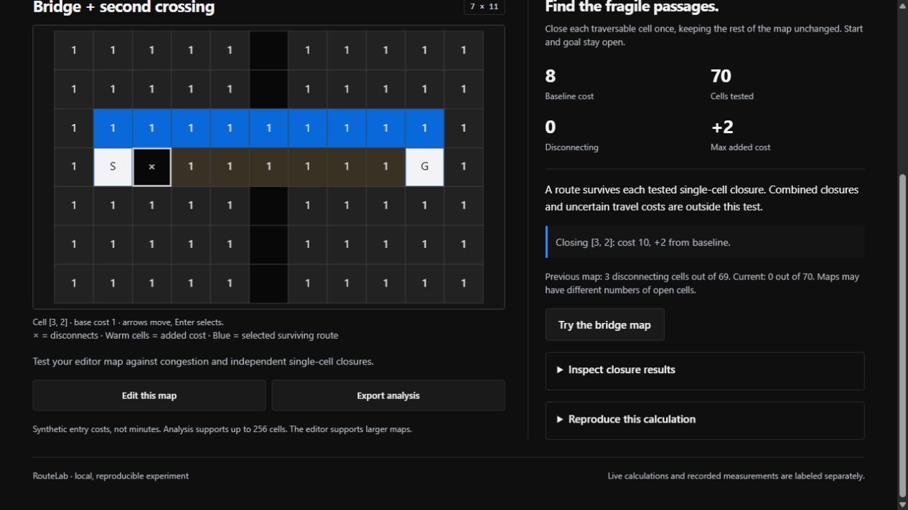
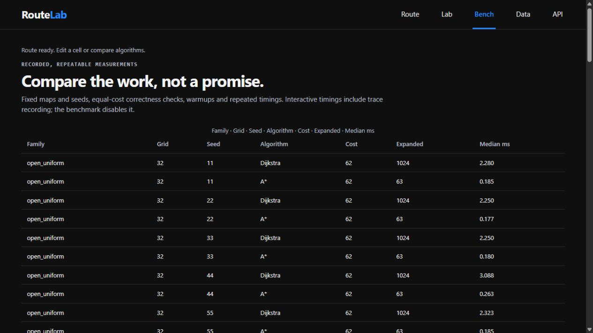
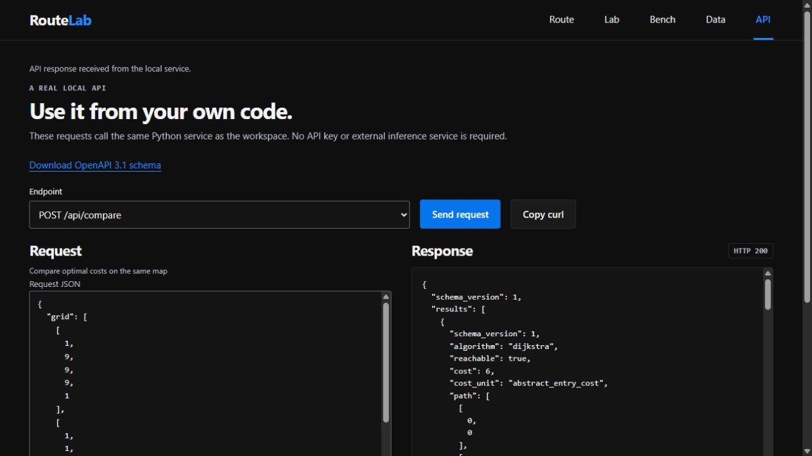
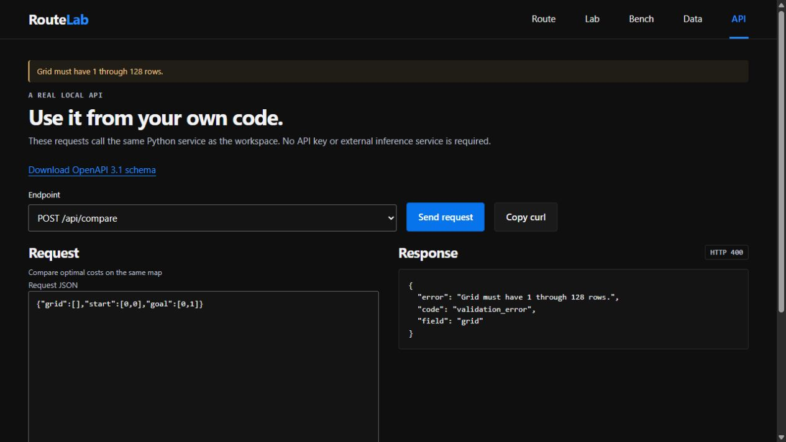

# RouteLab: annotated walkthrough

Current source version: **0.1.1**. Capture date: **2026-10-21**.

Fresh visual/API scenarios cover current-map solving, congestion, one-at-a-time closures, a second crossing and validation. Existing solver/oracle, asynchronous-import and keyboard tests support deeper behavior. The gallery does not model simultaneous closures, real roads or real traffic.

[Image hashes and timestamp basis](../screenshot-manifest.json). Captions distinguish current calculation, retained state and recorded research.

## 01. Compare two optimal solvers

Run A* and Dijkstra on the same weighted grid. Both find cost 26 in this example. Expansion counts describe this map, not a universal speed advantage.

1265 × 1310 px · actual browser screenshot · source 0.1.1

## 02. Traffic as a modeled cost

Select the rush-hour scenario. Increased tile costs make a six-cost detour preferable to the seven-cost reference path; these are synthetic costs, not live traffic.

1265 × 712 px · actual browser screenshot · source 0.1.1

## 03. Inspect the map on a narrow screen

Use the same congestion scenario in the responsive browser layout. This screenshot checks presentation, not a physical phone.

375 × 812 px · actual browser screenshot · source 0.1.1

## 04. Find a fragile crossing

Run the single-tile closure sweep. Three of 69 tested closures disconnect this map. Each trial closes one tile independently.

1265 × 712 px · actual browser screenshot · source 0.1.1

## 05. Test a proposed improvement

Add the second crossing and repeat the sweep. All 70 tested single-tile closures remain connected; the maximum added route cost is two in this scenario.

1265 × 712 px · actual browser screenshot · source 0.1.1

## 06. Read the recorded benchmark

Inspect the 90 recorded rows and their route/expansion results. These are historical runs, separate from the current map calculation.

1265 × 712 px · actual browser screenshot · source 0.1.1

## 07. Call the solver API

Send POST /api/compare through the application console. The local server returns HTTP 200 and the two algorithms agree on detour cost six.

1265 × 712 px · actual browser screenshot · source 0.1.1

## 08. Reject an invalid grid

Send an empty grid. The server returns HTTP 400 with a grid validation error instead of constructing an invalid route.

1265 × 712 px · actual browser screenshot · source 0.1.1
