# UnknownVision: annotated walkthrough

Current source version: **0.4.0**. Capture date: **2026-10-21**.

Fresh screens cover upload, abstention, selected misclassification, manual review, local save/reopen after a backend restart, unverified search, study, digit baseline and API errors. The capture saved one synthetic-demo review and did not retrain a model. Deletion behavior relies on the repository test records rather than a new destructive capture. Arbitrary-photo recognition remains unreliable.

[Image hashes and timestamp basis](../screenshot-manifest.json). Captions distinguish current calculation, retained state and recorded research.

## 01. Open the research workspace

Open the curated-example workspace. The following detail image shows the selected bird-to-dog failure; this overview introduces the research question and upload controls.

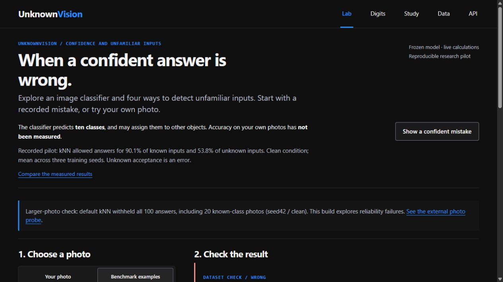

1265 × 712 px · actual browser screenshot · source 0.4.0

## 02. Separate prediction from source truth

Inspect the accepted dog label alongside the preserved bird annotation. Confidence measures the classifier score, not correctness.

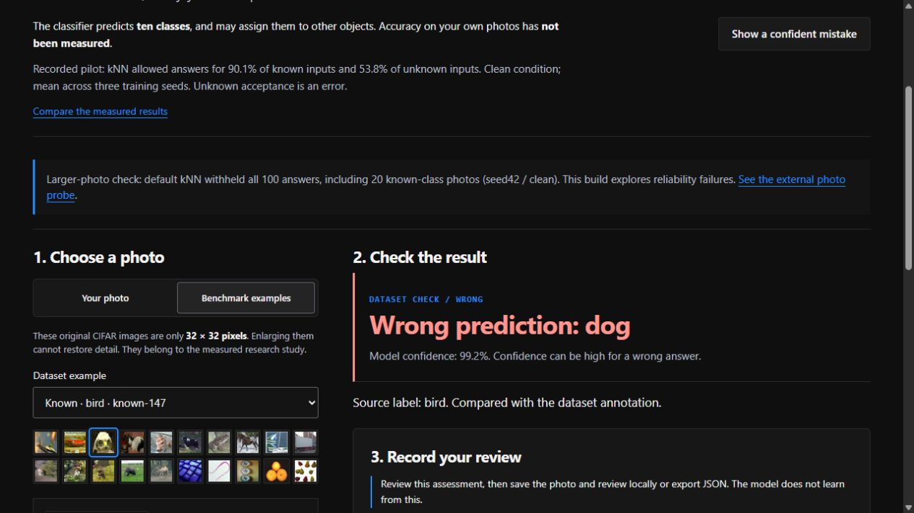

1265 × 712 px · actual browser screenshot · source 0.4.0

## 03. Report a model error

Choose Wrong, enter bird / owl and apply the correction. Your review stays separate from the model label and dataset annotation; it does not retrain the model.

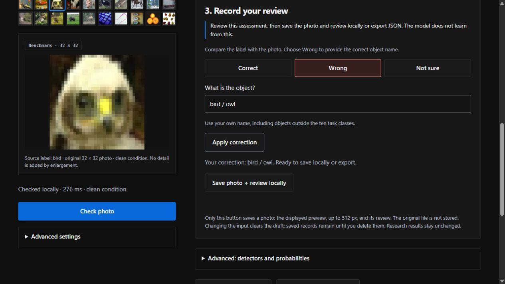

1265 × 712 px · actual browser screenshot · source 0.4.0

## 04. Save one explicit local review

Use Save photo + review locally for the curated bird. The list shows the new demonstration record. No original personal photograph was saved.

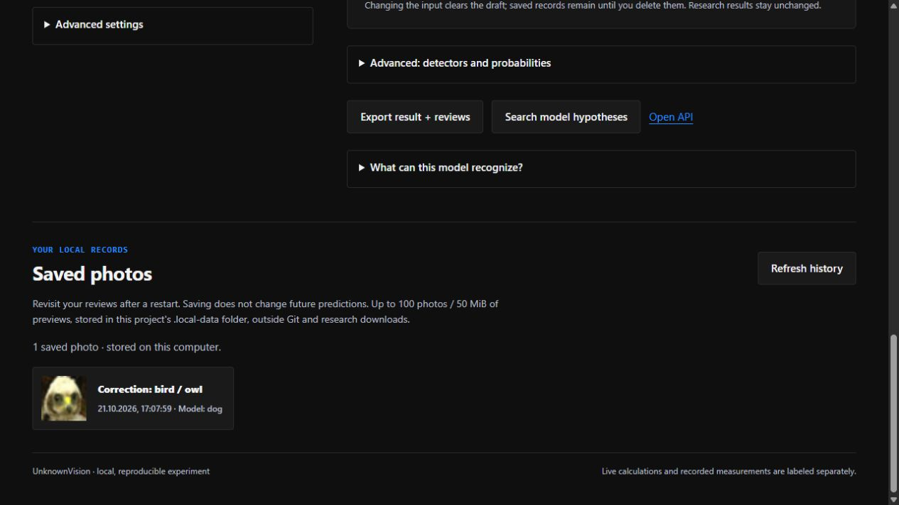

1265 × 712 px · actual browser screenshot · source 0.4.0

## 05. Open a saved record

Select the demonstration bird review from local history. This frame shows the entry and snapshot heading; the after-restart frame below shows the stored fields.

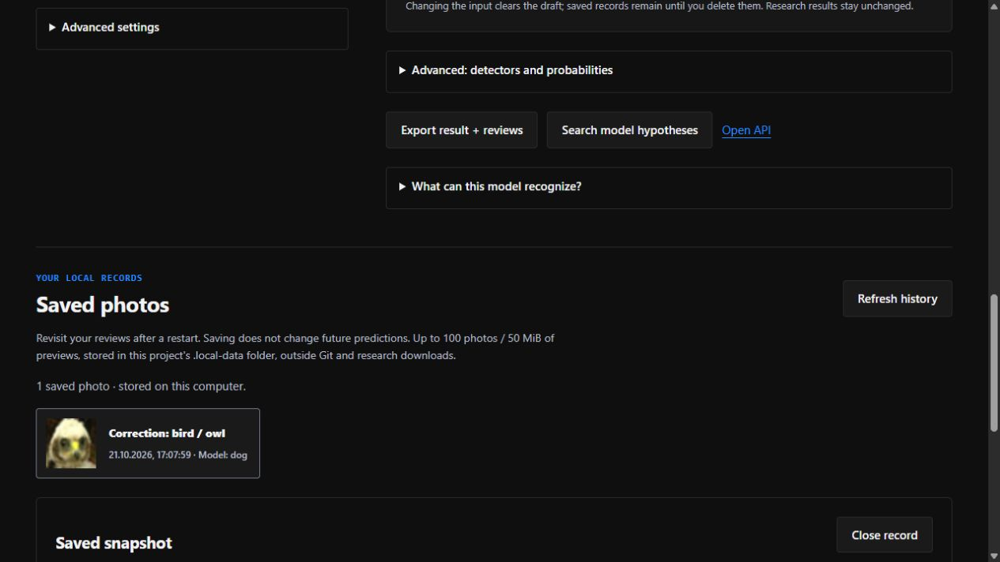

1265 × 712 px · actual browser screenshot · source 0.4.0

## 06. Retain the review after a server restart

Stop and restart the Python backend, reload the browser and reopen the demonstration bird record. The saved preview and correction remain available; model predictions remain separate.

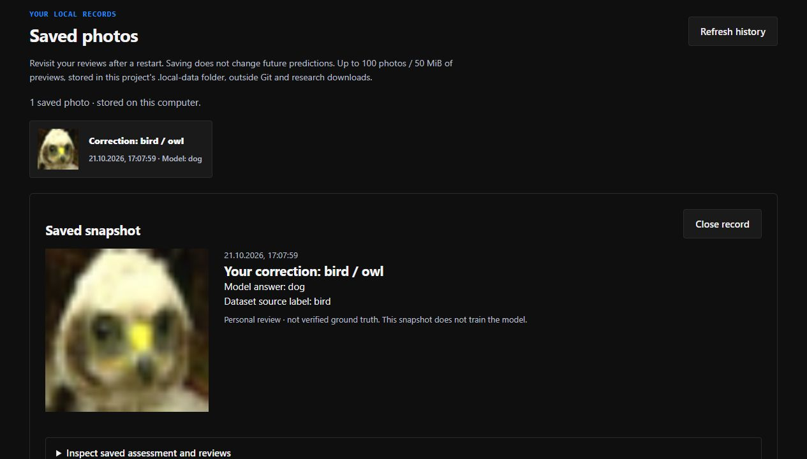

1265 × 720 px · actual browser screenshot · source 0.4.0

## 07. Withhold a task label

Assess the curated unfamiliar keyboard example with kNN. The application shows an abstention and preserves the hidden task-class scores for inspection.

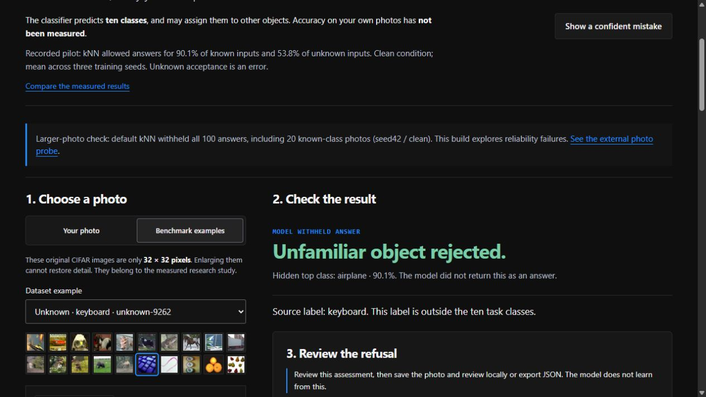

1265 × 712 px · actual browser screenshot · source 0.4.0

## 08. Inspect unverified web suggestions

After abstention, the service sends text hypotheses to Wikipedia and displays related articles with source links. It does not upload the photo or establish its identity.

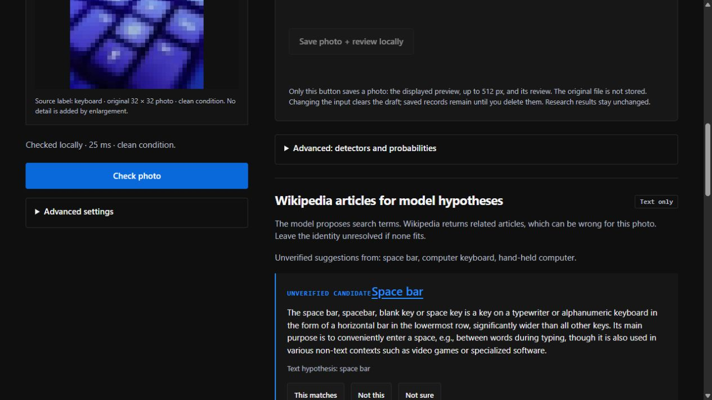

1265 × 712 px · actual browser screenshot · source 0.4.0

## 09. Review a proposed article

The capture session selects This matches for the Computer keyboard candidate as a UI demonstration. This click is not an independent identification study or verified ground truth.

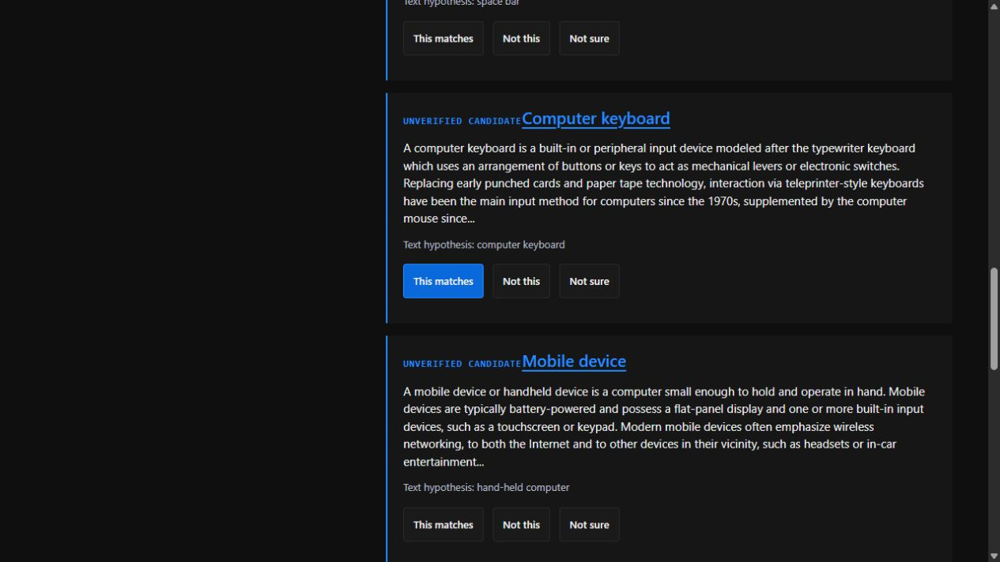

1265 × 712 px · actual browser screenshot · source 0.4.0

## 10. Choose an actual external photo

Upload the credited NASA Blue Marble JPEG through the real file chooser. This screen precedes inference; it demonstrates file selection rather than a recognition result.

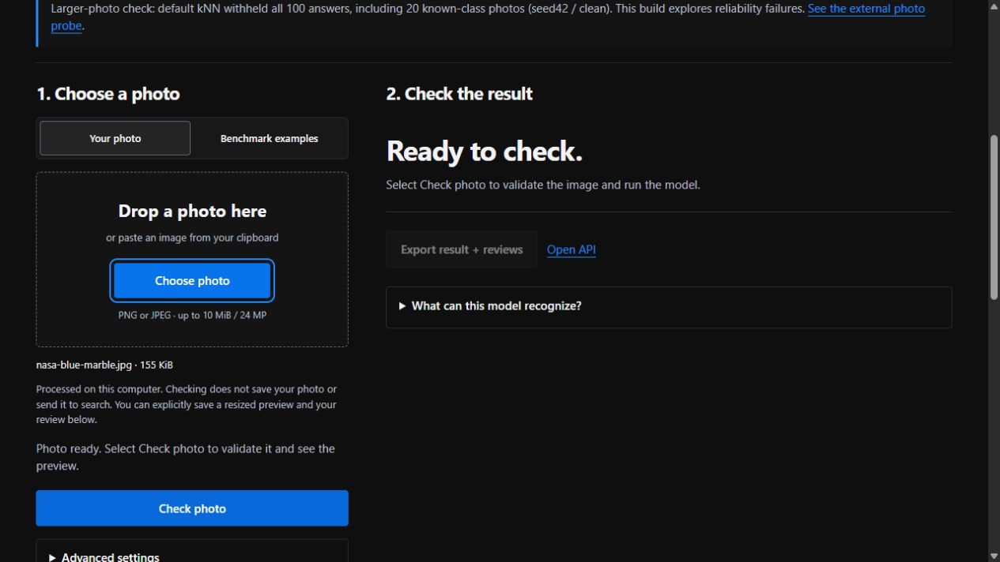

1265 × 712 px · actual browser screenshot · source 0.4.0

## 11. Keep an unresolved photo unresolved

Check the uploaded Earth photo locally. The selected detector withholds an answer; hidden bird 69.3% is not returned as an identification. The model has no verified label for this upload.

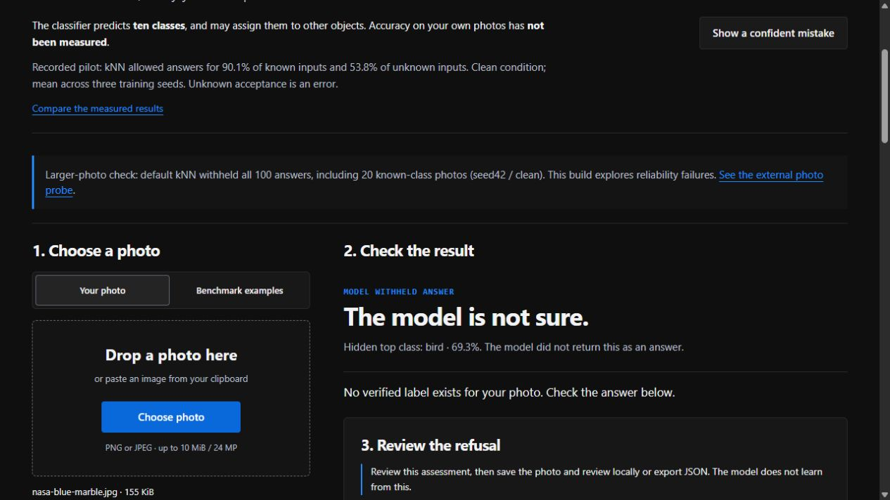

1265 × 712 px · actual browser screenshot · source 0.4.0

## 12. Inspect the uploaded photo and decision together

The actual NASA Earth image and the local abstention appear in the same workspace. The input has no added blur; the model still does not recognize it reliably.

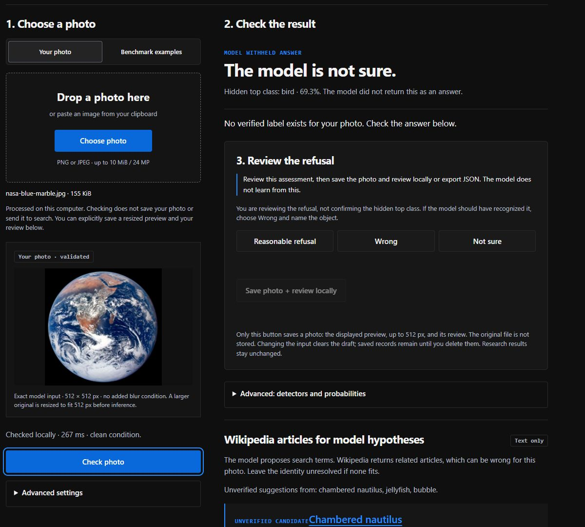

1200 × 1080 px · actual browser screenshot · source 0.4.0

## 13. Compare detector decisions

For the same Earth photo, probability methods allow an answer while distance and kNN reject it. Each method uses its own threshold and scale.

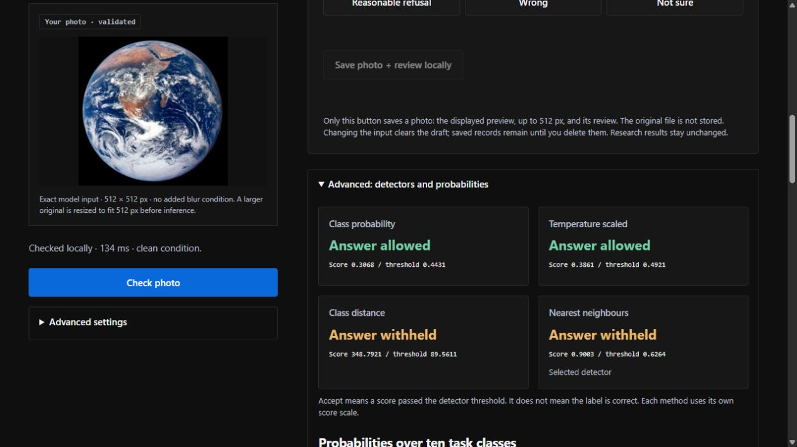

1265 × 712 px · actual browser screenshot · source 0.4.0

## 14. Choose a photo on a narrow layout

Inspect the actual responsive upload control with the NASA file selected. This is a browser viewport check, not a physical-phone result.

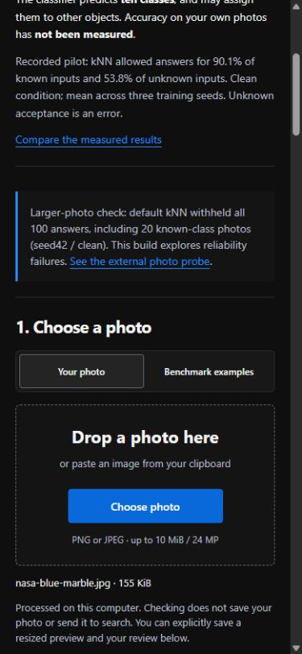

375 × 812 px · actual browser screenshot · source 0.4.0

## 15. Read all recorded methods

Compare known coverage and unknown acceptance across the three-seed CIFAR pilot. Unknown acceptance is a failure; these rates do not measure arbitrary personal photos.

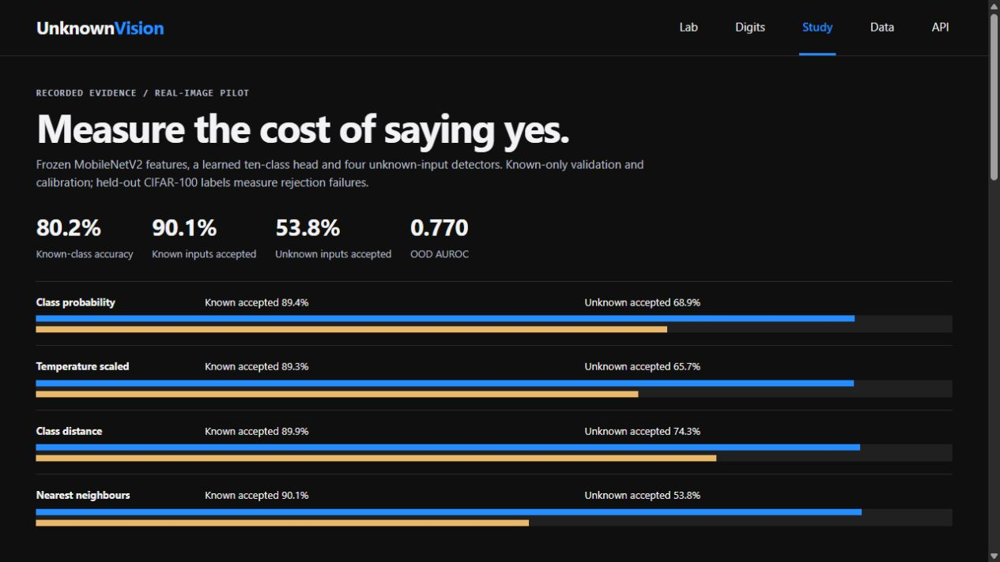

1265 × 712 px · actual browser screenshot · source 0.4.0

## 16. Show failed transfer to larger photos

Inspect the fixed 100-photo external probe. Default kNN rejects all photos, including 20 task-known photos; probability methods accept most task-unknowns.

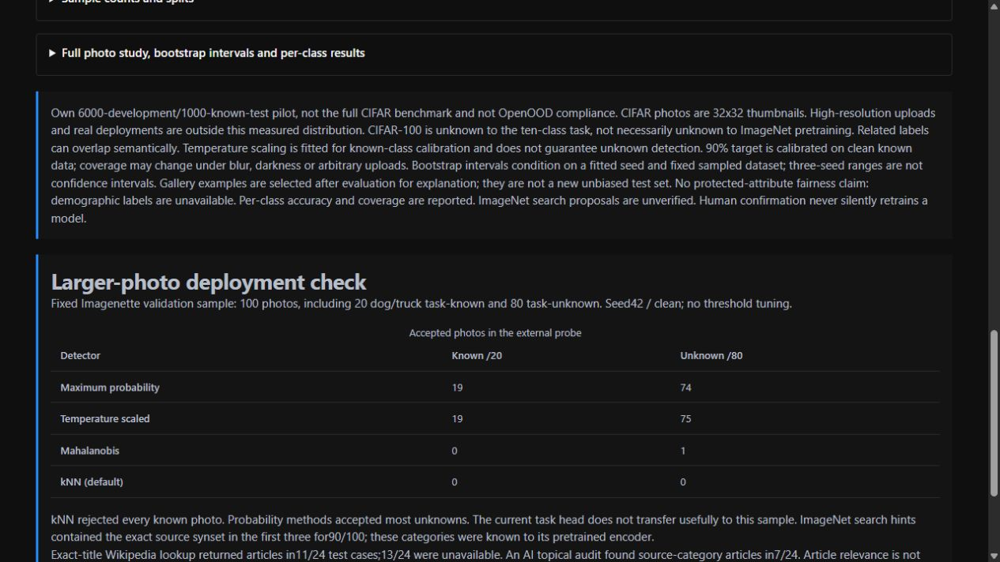

1265 × 712 px · actual browser screenshot · source 0.4.0

## 17. Call photo inference through the API

Send POST /api/photo-predict. The visible beginning of the HTTP 200 JSON separates abstained status, hidden prediction and null returned label. Scroll the live console for source truth and all detector scores; the OpenAPI contract documents those fields.

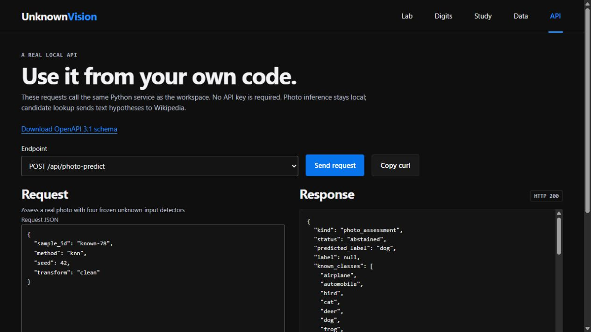

1265 × 712 px · actual browser screenshot · source 0.4.0

## 18. Reject a missing sample

Send a nonexistent sample ID. The server returns HTTP 400 and validation_error.

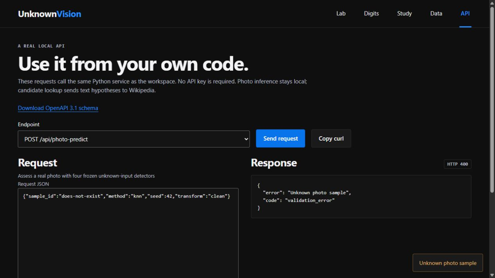

1265 × 712 px · actual browser screenshot · source 0.4.0

## 19. Inspect the earlier controlled baseline

Assess digit eight, withheld from the digit task training classes zero to seven. The model abstains. This eight-by-eight experiment remains separate from real-photo recognition.

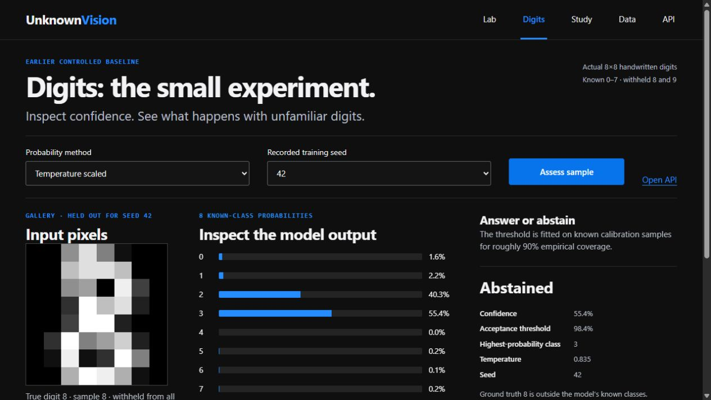

1265 × 712 px · actual browser screenshot · source 0.4.0

## 20. Reject a corrupt image

Select and check a deliberately corrupt JPEG fixture. The application reports Invalid or oversized image and produces no assessment or result export.

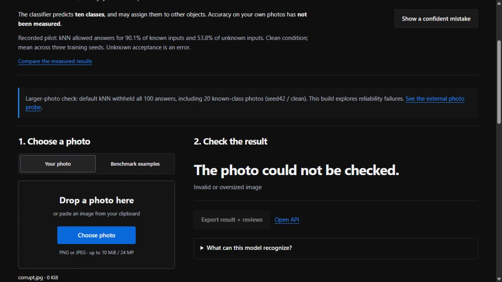

1265 × 712 px · actual browser screenshot · source 0.4.0

## Uploaded demonstration photo

The Blue Marble, Apollo 17, AS17-148-22727. Credit: NASA / Johnson Space Center. [Official source](https://science.nasa.gov/resource/the-blue-marble/). The public NASA photo tests upload and inference; it is not a measured benchmark sample.
